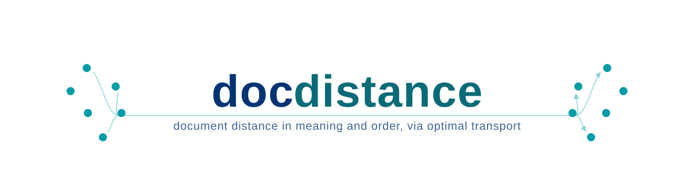

# docdistance

[](https://github.com/stellarshenson/docdistance/actions/workflows/ci.yml)
[](https://pypi.org/project/docdistance/)
[](https://pepy.tech/project/docdistance)
[](https://github.com/stellarshenson/copier-data-science)
[](https://medium.com/towards-artificial-intelligence/docdistance-a-way-to-measure-distance-between-documents-229d4f762eaf)
[](https://humes.pl/en/)

## Overview

docdistance measures how far apart two documents are - in meaning and in order - and points to exactly which sentences changed. It is built for pipelines where an AI model rewrites, converts, extracts, or summarizes a document and you need to check, automatically, whether the result still says the same thing.

<p align="center">
  
</p>

## Features

- **Two kinds of distance** - one for meaning (did the content change?), one for order (was the same content rearranged?)
- **Points to what changed** - a per-statement diff that tells a reworded sentence apart from one that only moved, not just a single score
- **Source-aware option** - compare two documents against a shared source to see which one drifted, and whether it dropped or invented content
- **No model internals needed** - works from the text alone, so it runs on frontier-model output where token probabilities are unavailable
- **Batch scoring** - `--pairs` scores a whole TSV of document pairs with one model load, one JSON line per pair, on all three distance commands; a document file that recurs across rows is encoded once
- **Markdown- and HTML-aware** - the reader of each document follows its file extension: a `.md` or `.markdown` file is read as markdown (table rows, headings and list items become statements), a `.html` or `.htm` file is converted to those lines first, every other file and raw text go whole to the prose segmenter; `--input-format plain|markdown|html` names one reader for every document, and `plain` restores the 1.1.5 reading; `--min-words` / `--skip-table-fragments` filter fragments
- **Runs anywhere** - CPU-only by default (OpenVINO INT8), sub-millisecond for the meaning score, no GPU required
- **CLI or Python** - `docdistance distance-semantic a.md b.md`, or `from docdistance import semantic_distance`
- **Interpretable by design** - every score comes with the statement-to-statement alignment behind it

*A tool for measuring how far a document has drifted from its source, written by authors who could not stop the scope drifting from one distance to three. The irony is not lost on us - merely, and optimally, transported.*

Semantic distance between two documents via Statement Mover's Distance - optimal transport over mmBERT statement embeddings, after Kusner et al. 2015 ([*From Word Embeddings To Document Distances*](references/papers/%5Bpaper%20digest%5D%20From%20Word%20Embeddings%20To%20Document%20Distances.md)). A thin frontend to the library; the SOTA docs carry the mechanics, benchmarks, and validation.

- **Input** - two documents, raw text or a file path
- **Output** - an SMD distance, a 0..1 closeness, a verdict, and the statement alignment
- **Use** - agentic document conversion and extraction pipelines, where token logits are unavailable and KL divergence cannot be computed
- **Unit** - statement-level and position-invariant, with an interpretable transport plan

## Theory

A document distance grounded in embeddings and optimal transport, not surface overlap.

- **WMD** - Word Mover's Distance (Kusner et al. 2015) casts document similarity as optimal transport between embedded tokens
- **SMD** - this project lifts it to statements: segment, embed, transport between the two statement clouds
- **Beyond cosine** - whole-document cosine collapses when the same claims sit in a different place or order; statement-level content transport is position-invariant, so `distance-semantic` scores meaning regardless of where a claim sits
- **Structure** - order is not discarded, it is resolved on a separate axis: the OPW order-gap, the extra transport cost an order-preserving plan pays over the content-optimal one - near `0` when content already lines up in order, larger on a genuine reorder; `distance-structural` reports `structure_closeness = 1 − order_gap/√2` (a score, not a metric)
- **Metric** - the content ground cost `√(2 − 2cos)` on L2-normalized embeddings is a metric, so the semantic document distance is one too
- **Logit-free** - an embedding-grounded alternative where token probabilities (KL divergence) are unavailable, as in frontier-model pipelines

## Method

Three stages; the transport plan is the interpretable by-product.

1. **Segment** - split each document into atomic statements with the SAT (Segment Any Text) segmenter
2. **Embed** - encode each statement with the mmBERT contextual encoder (mean-pooled, L2-normalized)
3. **Compare** - exact optimal transport between the two statement clouds (Statement Mover's Distance), balanced with uniform marginals

- **Closeness** - `1 − SMD/√2`, on a 0..1 scale
- **Source-conditioned** - a variant `d(A, B | S)` re-bases the transport onto a shared source `S` and reads off a selection axis and a grounding axis

## Which distance

Three reads over the same two documents; they differ in what the answer tells you and what you must supply.

- **Method 1 - semantic distance (robust, fast)** - `distance-semantic` answers *how far apart are A and B in meaning?* as one number (a 0..1 closeness plus a similar / not-similar verdict). Sub-millisecond, needs only the two documents, and is a true metric - the distance is symmetric and obeys the triangle inequality, so the numbers are consistent enough to threshold, rank and cache. The production default; use it whenever you need a reliable similarity score - dedup, drift detection, "did this conversion change the meaning?"
- **Structural read (what moved vs what stayed put)** - `distance-structural` is a first-class command, no extra model and no source: it returns a per-statement order projection where `displacement` / `moved` name what MOVED in arrangement, plus a whole-document `order_gap` and `structure_closeness` (0..1, `1` = same order) via the OPW order-gap. Pair it with `distance-semantic`'s content details (`changed`) to tell a reword from a pure rearrangement (see [Structure distance](#structure-distance) below, and a worked [map + diff interpretation](docs/example-map-interpretations.md))
- **Method 2 - source-conditioned `d(A, B | S)` (slower, experimental)** - answers *why do A and B differ, given a shared source S?* You supply `S`, and instead of one number it returns two axes: a selection axis (did A and B pick different parts of the source?) and a grounding axis (did one drift from the source - dropped content vs unsupported or fabricated content?). It runs a cross-encoder × NLI pass (~seconds on GPU, far slower on CPU). Use it to audit a summary or an extraction against its source, when "how far" is not enough and you need to name the failure
- **Which to pick** - default to Method 1 for a similarity number, add the structural read when you need to see *what* moved and where, and reach for Method 2 only when you hold the shared source and need to know *why* two documents derived from it diverge. Method 2's value is interpretation and ordering the failure modes correctly, not a higher pass rate, and it is validated on a single fixture so far - validate on your own sources first.

## Usage

The quickest way to a result is the CLI - init once, then run it. Python 3.12 to 3.14 is supported; releases up to 1.1.5 install on Python 3.13 only.

```bash
pip install docdistance                        # from PyPI ('docdistance[s3]' to pull models from S3)
docdistance init wmd                           # provision the symmetric-distance models (once)
docdistance init wmd-wrt-source                # + the reranker + NLI grounding models
docdistance --help                             # full reference (or <command> --help)

# method 1 - semantic distance (robust, fast, the default)
docdistance distance-semantic a.md b.md                 # rich verdict (add --json for machine-readable)
docdistance distance-semantic a.md b.md --details-json details.json   # + statement → statement content alignment

# structural read - order / arrangement distance
docdistance distance-structural a.md b.md                 # order-gap verdict (add --json for machine-readable)
docdistance distance-structural a.md b.md --details-json details.json   # + per-statement order projection

# batch - many pairs, one model load (all three distance commands)
docdistance distance-semantic --pairs pairs.tsv          # TSV a<TAB>b[<TAB>id] → one JSONL line per pair
docdistance distance-semantic --pairs pairs.tsv --details-json 'details/{pair}.json'   # + one detail file per pair
docdistance distance-wrt-source --pairs pairs.tsv -s s.md   # every pair against one source

# the reader follows the file extension: .md / .markdown markdown, .html / .htm HTML, every other file and raw text plain
docdistance distance-semantic page.html page.md           # an HTML document against its markdown conversion
docdistance distance-semantic a.md b.md --min-words 3 --skip-table-fragments   # + fragment filters
docdistance distance-semantic a.txt b.txt --markdown      # one reader for every document: here markdown
docdistance distance-semantic a.md b.md --input-format plain   # the reader and the numbers of 1.1.5

# method 2 - source-conditioned d(A,B|S) (slower, runs the reranker × NLI grounding)
docdistance distance-wrt-source a.md b.md --source s.md                       # two-axis verdict
docdistance distance-wrt-source a.md b.md -s s.md --source-map-json map.json   # + statement → source map
```

`init` provisions a mode's models from HuggingFace by default, or from S3 (`--source s3://your-bucket --aws-profile NAME`) or a local mirror (`--source /path/to/models`), and records readiness in a `docdistance.json` written to `$DOCDISTANCE_HOME` or the current folder. A distance run whose mode was never init'd exits with a clear "run `docdistance init <mode>`" error.

`--input-format` takes `auto`, `plain`, `markdown` or `html` on the three distance commands; the Python calls take `input_format=`. The default is `auto`: the reader of each document is chosen from its file extension, in any letter case. The content is not read for the choice.

| Document | Reader under `auto` |
| --- | --- |
| a `.md` or `.markdown` file | `markdown` |
| a `.html` or `.htm` file | `html` |
| a file with another extension, a file without extension, raw text | `plain` |

An explicit `plain`, `markdown` or `html` is the reader of every document of the call, and `--markdown` / `markdown=True` equals `markdown`. Releases up to 1.1.5 read every document with the plain reader, so the numbers for `.md`, `.markdown`, `.html` and `.htm` files can differ from 1.1.5 unless `--input-format plain` / `input_format="plain"` is passed, which restores the 1.1.5 reading.

- **`plain`** - the whole text goes to the prose segmenter
- **`markdown`** - one statement per heading, table row, list item and fenced-code line; only prose paragraphs go through the prose segmenter
- **`html`** - the document is converted to markdown lines, which the markdown reader then segments: `h1` to `h6` become `#` lines, `li` a `- ` line in a `ul` and a numbered line in an `ol` (`1. `, `2. `, counted from 1 in each `ol`; a nested item indented by two spaces per level), `tr` one `| cell | cell |` row of its `td` and `th` texts, `pre` a fenced block, `p` / `div` / `blockquote` / `section` / `article` / `dt` / `dd` / `figcaption` / `caption` / `header` / `footer` / `main` / `nav` / `aside` / `address` / `form` / `figure` / `details` / `summary` and text outside any block a paragraph on one line with its whitespace collapsed to single spaces; `br` is the only line break inside a paragraph and `hr` ends a paragraph; `script`, `style`, `template`, `noscript`, `svg`, `title`, comments and a byte order mark are dropped; every other tag, `head` among them, leaves its text only. The `h1` of an HTML file is removed like the `# ` title line of a markdown file. The statements of an HTML document do not depend on how its source text is wrapped

Or from Python:

```python
import docdistance
from docdistance import semantic_distance, structural_distance, source_conditioned_distance

docdistance.init("wmd")                                         # provision once (writes docdistance.json)
r = semantic_distance("report_v1.md", "report_v2.md")           # method 1 - content
print(r.closeness, r.verdict)               # 0..1 closeness, "similar" | "not similar"

sr = structural_distance("report_v1.md", "report_v2.md")        # structural read - order
print(sr.structure_closeness, sr.order_gap, sr.verdict)   # 0..1 structure readout, order-gap, verdict

from docdistance import DocDistance
result, details = DocDistance().structural_distance_with_details("report_v1.md", "report_v2.md")   # StructuralResult + order details
print(details["smd"], details["order_gap"], details["structure_closeness"])   # semantic distance, structural order-gap, 0..1 structure readout
print(result.matched_order_gap, result.n_matched)   # order gap over the statements both documents hold, and their count

dd = DocDistance(memo_size=64)              # for sweeps: a document file that recurs across calls is encoded once

docdistance.init("wmd-wrt-source")                              # + reranker + NLI grounding models
s = source_conditioned_distance("sum_a.md", "sum_b.md", source="article.md")  # method 2
print(s.d_sel, s.grd_a, s.grd_b)            # selection divergence + each doc's grounding residual
```

### Reading the result

- **Method 1 - closeness 0..1** - `1.0` identical, `0.0` unrelated. Good (same meaning): closeness near 1, verdict `similar` (default cutoff `0.77`, set with `--threshold`). Bad (meaning changed): closeness falls toward 0, verdict flips to `not similar`
- **Method 2 - two axes, lower is closer** - `d_sel` near 0 means A and B drew on the same source content, high means they picked different parts; `grd_a` / `grd_b` are each document's reranker x NLI grounding residual (E03-H11 relevance-gated ungrounded mass) - low means it stays grounded in `S`, high flags drift (dropped or unsupported content). Good: both grounding residuals and `d_sel` low. Bad: a grounding residual spikes for the document that drifted. `n_unsupported_a` / `n_unsupported_b` count the statements whose nearest source statement costs more than 0.34625 (embedding distance, not entailment). `residual_a` / `residual_b` are the transport cost to the whole source and grow when a document covers only part of it; they are not the unsupported share of a document
- **Structural read - two order gaps** - `order_gap` rises when statements are deleted and the order is kept, and the verdict can then read `not similar`; `matched_order_gap` is the order gap over the `n_matched` statements both documents hold and reads such a deletion at the identity floor of the shorter document ([readings](docs/solution/wmd-structure-distance-sota.md#calibration-of-the-structural-verdict)). The verdict is read from `order_gap` only

- **Transport map** - add `--details-json details.json` to `distance-semantic` to also write the optimal-transport map: for every statement of A, which statements of B its mass flows to, with the `weight` (fraction of that statement's mass) and the match `cost` - the interpretable statement-to-statement alignment behind the distance, readable by a human or a machine (the same map is returned in Python by `DocDistance.semantic_distance_with_details`)
- **Source map** - add `--source-map-json map.json` to `distance-wrt-source` to also write, for every statement of A and B, the top-3 source statements it covers with their weights - a per-statement alignment showing *which part of the source* each statement draws on; each record also names its nearest source statement (`nearest_source_index`, `nearest_source_cost`) and carries `unsupported`
- **Offline after init** - distance calls run fully offline once `docdistance init <mode>` has provisioned the mode (from HuggingFace, S3, or a local mirror) and written `docdistance.json`. `init --source` also saves the tokenizer of the SaT segmenter beside the SaT weights when the source folder `sat-3l-sm` holds none that loads with its special token ids, from the HuggingFace cache or else the Hub; a source folder that carries the tokenizer files that `init` saved needs no Hub; the tokenizer files as the Hub publishes them, and a truncated `tokenizer.json`, do not load that way and `init` replaces them (the `sat-3l-sm` bullet of the [AWS deployment reference](docs/aws-deployment-reference.md#models-and-footprint))
- **Backend** - `--backend openvino|torch`, default `openvino` (CPU INT8)
- **Machine-readable errors** - in `--json` / `--result-only` mode every failure writes a one-line `{"error": code, "message": ...}` object to stdout and exits 1 (codes `not_initialized`, `models_not_installed`, `io_error`, `empty_document`), so an agent parses stdout on both success and failure
- **Full reference** - the [CLI reference](docs/cli-reference.md), the [API reference](docs/api-reference.md) and the [AWS deployment reference](docs/aws-deployment-reference.md)

### Transport map output

`distance-semantic --details-json` writes the exact optimal-transport coupling behind the content distance - for each statement of A, the statements of B its probability mass moves to (one flow shown, a clean 1:1 match):

```json
{
  "generator": "docdistance",
  "version": "1.1.4",
  "smd": 0.286827,
  "closeness": 0.797183,
  "closeness_definition": "1 - smd/sqrt(2)",
  "thresholds": { "changed_cost": 0.325269, "no_counterpart_cost": 0.6 },
  "summary": { "n_changed": 3, "n_no_counterpart": 1, "top_changed": [7, 4, 2] },
  "n_statements": { "a": 12, "b": 11 },
  "sections": [ { "section": "Overview", "n_statements": 5, "mean_cost": 0.2519, "share_below_changed": 0.8 } ],
  "flows": [
    {
      "index": 1,
      "text": "Among large organizations with more than 1,000 …",
      "section": "Overview",
      "matches": [
        { "target_index": 1, "target_text": "About 42% of organizations with more than 1,000 …", "weight": 1.0, "cost": 0.2237 }
      ],
      "changed": false,
      "identical": false,
      "no_counterpart": false
    }
  ],
  "targets": [
    { "index": 1, "text": "About 42% of organizations …", "section": "Overview", "best_source_index": 1, "min_incoming_cost": 0.2237, "total_incoming_weight": 1.0 }
  ]
}
```

- **Self-describing header** - `generator` / `version` name the producer, `closeness` ships beside its `closeness_definition`, and `thresholds` records every cutoff in force, so the file is interpretable without the CLI invocation that made it
- **summary / sections** - document-level aggregates (`n_changed`, `n_no_counterpart`, cost bands, the top changed statements) and a per-heading-section table, for a triage read before the per-statement detail
- **flows** - one entry per statement of A; `index` / `text` / `section` name it, `matches` are the B statements its mass lands on
- **weight** - fraction of that statement's mass to the target, sums to 1 per statement; a lone `1.0` is a clean 1:1 match, several smaller weights mean the statement splits across B
- **cost** - ground distance `√(2 − 2cos)` of the matched pair; low = semantically close, high = a forced move
- **changed** - `true` once the statement's cheapest match over the whole cost row clears the change cutoff `(1 − threshold)·√2`; the content drifted rather than staying within tolerance
- **no_counterpart / identical** - `no_counterpart` flags removed content (cheapest match above `no_counterpart_cost`), `identical` flags a normalised-text-equal counterpart
- **targets** - the B-side view, one entry per statement of B: its cheapest incoming source and total incoming weight, so ADDED content (a target no source feeds cheaply) reads directly
- **match_index / match_status** - written by builds after 1.1.5, which the sample above predates: a one-to-one matching of the statements labels each flow `kept` (with `match_index`, its B statement) or `removed`, and each `targets` entry `kept` (with `match_source_index`) or `added`; a pair needs a ground cost below `match_cutoff` 0.325, stated under `thresholds`, and `summary` counts `n_kept` / `n_removed` / `n_added`. An annotation: the plan and `smd` do not change. A current record is in the [worked example](docs/example-map-interpretations.md)
- **smd** - the distance the map realizes; `weight × cost` summed over all flows equals it
- **Reading it** - a statement mapped to its counterpart at `weight 1.0` and low `cost` is preserved; high cost or scattered weights flag a statement with no clean equivalent in B

### Reading a long report against a brief

To find the parts of a long report that matter for a short brief, pass the long document first and the brief second, and add `--relevance` to `distance-semantic` together with `--details-json`:

```bash
docdistance distance-semantic report.md brief.md --details-json map.json --relevance
```

- **Without `--relevance`** - every flow of the map carries `min_cost`, the cheapest ground cost of the statement over the brief (the number `changed` and `no_counterpart` are read on), and `best_target_index`, the brief statement that gives it
- **With `--relevance`** - each statement of the report gets `relevance` (the highest reranker score of the statement over the statements of the brief) and `relevance_target_index`; each statement of the brief gets `relevance` and `relevance_source_index`; each section gets `mean_relevance` and `relevance_rank` (1 is the most relevant); `summary.top_relevant` lists the most relevant statements and the header block `relevance` names the reranker. The score is the sigmoid of a reranker logit: a score, not a distance and not a probability of relevance, and not on one scale across pairs of documents. In Python: `DocDistance.semantic_distance_with_details(report, brief, relevance=True)`
- **Cost** - one reranker pass per pair of statements, `len(report) * len(brief)` pairs; the NLI model is not loaded, the reranker must be installed (`docdistance init wmd-wrt-source`). Measured with the OpenVINO reranker on a CPU shared with other jobs: 26.8 ms per pair, 8 to 22 minutes for one note of 22 to 56 statements against a report of 883 statements (E19)
- **Evidence, constructed documents** - on one report of two articles and two sets of 12 briefs written by the experimenter, the nearest ground cost ranks the target sections at a mean AUC of 0.5865 (first 12 briefs) and 0.6183 (second 12). The relevance reads 0.8611 on the second 12, which were not seen when it was chosen, above the nearest cost in 12 of 12 briefs; the share of target sections among the 2 best-ranked sections rises from 0.4167 to 0.9167 (E17, E18)
- **Evidence, public documents** - on one European Commission report of 883 statements and 13 briefing notes of the European Parliamentary Research Service of 23 to 56 statements, with the target sections of each note labelled before a note was scored, the nearest ground cost reads a mean AUC of 0.6374 and the relevance 0.8321, above the nearest cost in 13 of 13 notes. In the section reading of the experiment, which ranks the deepest numbered section or sub-heading with at least 5 statements and leaves out the introduction and chapter 1, a target section is among the 3 best-ranked for 12 of 13 notes, against 5 of 13 by the nearest cost (E19). `relevance_rank` of the map ranks every distinct section path, 113 on this report, 66 of them with fewer than 5 statements; the experiment did not measure the 3 best-ranked sections by `relevance_rank`
- **Nearest cost under `--anisotropy`** - on the public documents `min_cost` of a map written with `--anisotropy` reads a mean AUC of 0.7250 without a reranker, above the plain cost in 13 of 13 notes, with a target section among the 3 best-ranked for 12 of 13 notes in the same section reading of the experiment (E19); this was not measured on the sections of the map. On the constructed report, which covers one broad topic, the same pre-pass was above the plain cost in 7 of 12 briefs and did not meet its bar (E17)
- **Limits** - two fixtures: one constructed report with briefs by one author, and one public report with 13 notes whose target sections the experimenter assigned from the note titles, the heading tree and term counts. The readings are not a general result. On the public documents the relevance is 0.0074 and 0.0460 above the nearest cost for two of the 13 notes. No rule that marks match and no match for one brief is confirmed: splitting the scores with the Otsu method reads a balanced accuracy of 0.6400 on the constructed briefs, against a registered bar of 0.70, and 0.6846 on the public notes. Read the ranks, not a cutoff

### Order details output

`distance-structural --details-json` writes the order projection - for every statement of A, its aligned B statement and the order displacement that names what MOVED:

```json
{
  "generator": "docdistance",
  "version": "1.1.4",
  "smd": 0.286827,
  "order_gap": 0.041185,
  "structure_closeness": 0.970878,
  "structure_closeness_definition": "1 - order_gap/sqrt(2)",
  "thresholds": { "moved_tolerance": 0.05, "no_counterpart_cost": 0.6 },
  "summary": { "n_moved": 2, "n_no_counterpart": 1, "median_displacement_norm": 0.0076 },
  "n_statements": { "a": 12, "b": 11 },
  "statements": [
    {
      "index": 0,
      "text": "Among large organizations with more than 1,000 …",
      "section": "Overview",
      "target_index": 0,
      "target_text": "About 42% of organizations with more than 1,000 …",
      "target_section": "Overview",
      "cost": 0.2237,
      "semantic_target_index": 0,
      "targets_differ": false,
      "displacement": 0,
      "displacement_norm": 0.0,
      "moved": false,
      "no_counterpart": false
    }
  ]
}
```

- **statements** - one entry per statement of A; `index` / `text` / `section` name it, `target_index` / `target_text` / `target_section` are its aligned counterpart in B (crisp exact-EMD alignment, not the soft OPW plan)
- **displacement / displacement_norm** - rank shift of the statement from its aligned position; `displacement` is the raw shift (`0` = in place), `displacement_norm` is the length-normalised form `target_index/n_b − index/n_a`
- **matched_displacement / moved** - written by builds after 1.1.5, which the sample above predates: `matched_displacement` is the rank shift of the statement among the statements both documents hold (one-to-one pairs with a ground cost below `match_cutoff` 0.325), `null` without a match. `moved` is true when the statement is matched, `matched_displacement` is not 0, `abs(matched_displacement / n_matched)` is above `moved_tolerance` and the record is not `no_counterpart`; 1.1.5 read `abs(displacement_norm) > moved_tolerance`. A statement inserted or removed without a match flags nothing. On a document that repeats a statement this does not always hold: `moved` flagged a kept statement in 4 of 120 pure deletions of a 62-statement document with 9 repeated statements (E15-H80; bullet "Limit: repeated statements" of the [API reference](docs/api-reference.md#matching-and-the-matched-order-gap))
- **matched_order_gap / n_matched** - in the `--json` result after 1.1.5, not in the details file: the order gap over the `n_matched` matched statements, `null` when none is matched
- **cost** - ground distance of the aligned pair; above `no_counterpart_cost` the alignment names no real counterpart, `displacement_norm` goes null and `no_counterpart` flags it
- **semantic_target_index / targets_differ** - the heaviest semantic target of the content-optimal plan beside the order alignment; `targets_differ: true` names a statement that MOVED AND was reworded
- **Self-describing header** - `generator` / `version`, the closeness definition, every threshold in force, `summary` aggregates (`n_moved`, `n_no_counterpart`, median displacement) and a per-`sections` table, matching the semantic detail file
- **smd** - the top-level semantic distance (content only), order-invariant - the same number `distance-semantic` reports
- **order_gap** - the H55 OPW structural distance (order-gap = OPW cost − SMD), translation-invariant and `>= 0`; `0` = same order
- **structure_closeness** - `1 − order_gap/√2`, the shipped SOTA 0..1 readout on the same scale as SMD closeness; `1` = same order, falling toward `0` as the arrangement diverges
- **Reading it** - `displacement` isolates what MOVED in order; a statement at `displacement` 0 kept its place while a large `displacement` was relocated. To tell a reword from a pure rearrangement, read it beside `distance-semantic`'s content `changed`

## Structure distance

SMD is position-invariant by design - reorder a document's statements and it barely moves. A second, structure-sensitive number tells *content drift* from *rearrangement*, and it ships as its own command (`structural_distance`, `distance-structural --details-json`), reported beside SMD. The shipped mechanism is the OPW order-gap (E11-H55); the earlier position-augmented Wasserstein metric was stress-tested against it and dropped.

- **OPW order-gap (H55, shipped)** - `order_gap = OPW − SMD`, the order-preserving Wasserstein cost minus the order-free SMD. Subtracting SMD cancels the content component, so only the extra cost the order constraint forces remains - a faithful reword with order kept reads ~0, a reorder with content kept reads large. Reported as `structure_closeness = 1 − order_gap/√2` on the library's 0..1 closeness scale, the same readout as semantic closeness (`1` = same order)
- **Content-invariant, translation-invariant** - the reword reads 0.4% of a full-scramble distance (stored 0.0038) and the dropped metric 61.5% (stored 0.615), it is monotone in displacement (Spearman 1.00), and it reads fractional statement rank `i/N`, not absolute position, so a uniform shift (a header inserted, everything offset, relative order intact) is invisible. A translation-invariant score, `order_gap >= 0`, not a metric - the entropic OPW carries ~15% triangle violations (measured, `reports/E11-structure-sota-decision.json`), never invoked for a pairwise arrangement read
- **Two axes side by side** - read the structural order-gap beside the semantic distance (SMD, order-invariant); when meaning is preserved (SMD ≈ 0) but `structure_closeness` falls, the arrangement changed and nothing else. `distance-structural`'s per-statement `displacement` names what MOVED in order, and `distance-semantic`'s per-flow `changed` names what changed in MEANING - the structural analogue of the transport map
- **The metric that was dropped** - position-augmented Wasserstein (E08-H44) is a true metric, but fuses semantic and positional cost into one distance `√((1−λ)·d_sem² + λ·d_pos²)`, so a faithful reword reads as far as a real reorder (E11) - a metric on the wrong quantity. E11 chose the order-gap and dropped it
- **Design and evidence** - the [structure-distance SOTA](docs/solution/wmd-structure-distance-sota.md), the [experiments log](docs/experiments/wmd-structure-distance-experiments.md) (E07 the barycentric read, E08 the metric formulation, E10-H55 the order-gap mechanism, E11 the decision), and the end-to-end notebook `notebooks/12-kj-structure-distance-e2e.ipynb`

## Dataset

Both datasets are generated end-to-end from public third-party articles - nothing ships pre-staged, and the whole corpus rebuilds from scratch by running one notebook.

- **Two datasets, one foundation** - a WMD / source-conditioned corpus (the executive summaries E01-E06 consume) and a structure-distance fixture (E07-E11), both derived from the same AWS Bedrock exec-summary corpus
- **Complete and independent** - `notebooks/11-kj-structure-fixture.ipynb` runs the full pipeline unattended: fetch the source PDFs (`data/external/download-fixtures.py`), convert them to curated text, summarise under the executive-summary gold rules (Bedrock opus / sonnet / haiku), segment into statements, opus-mt back-translate, and assemble the fixture - no external file has to be staged by hand
- **Reproducible** - the fetch and the generation are cache-backed and deterministic where possible; only the two curated `source-article.md` inputs are hand-reviewed, everything downstream regenerates
- **Recipe** - [`docs/dataset/dataset-generation-recipe.md`](docs/dataset/dataset-generation-recipe.md) walks the external → interim → processed flow, the gold-rules writing contract, and the from-scratch rebuild

## Documentation

The SOTA documents explain how it works in detail; this README only introduces it.

- [`docs/solution/wmd-docdistance-solution-sota.md`](docs/solution/wmd-docdistance-solution-sota.md) - source-free distance: design, mechanism, performance, validation
- [`docs/solution/wmd-source-conditioned-docdistance-solution-sota.md`](docs/solution/wmd-source-conditioned-docdistance-solution-sota.md) - source-conditioned distance `d(A,B|S)`: two axes (selection + grounding), design, performance, limitations
- [`docs/solution/wmd-structure-distance-sota.md`](docs/solution/wmd-structure-distance-sota.md) - structure-sensitive distance: the OPW order-gap (`OPW − SMD`) and `structure_closeness`, shipped as `distance-structural`; theory, the structural mapping, limitations
- [`docs/example-map-interpretations.md`](docs/example-map-interpretations.md) - a worked, grounded example: reading the `--details-json` outputs of `distance-semantic` and `distance-structural` to localize what changed between two documents (blind-recovery of four known edits)
- [`docs/mmbert-quantization-solution.md`](docs/mmbert-quantization-solution.md) - the INT8 / FP8 statement encoder
- [*From Word Embeddings To Document Distances*](references/papers/%5Bpaper%20digest%5D%20From%20Word%20Embeddings%20To%20Document%20Distances.md) - Kusner et al. 2015, the WMD theory
- [*All-but-the-Top: Simple and Effective Postprocessing for Word Representations*](references/papers/%5Bpaper%20digest%5D%20All-but-the-Top%3A%20Simple%20and%20Effective%20Postprocessing%20for%20Word%20Representations.md) - Mu & Viswanath, ICLR 2018, the anisotropy postprocessing
- [*SummaC: Re-Visiting NLI-based Models for Inconsistency Detection in Summarization*](references/papers/%5Bpaper%20digest%5D%20SummaC%20-%20Re-Visiting%20NLI-based%20Models%20for%20Inconsistency%20Detection%20in%20Summarization.md) - Laban et al., TACL 2022, the multi-premise NLI grounding pattern behind the source-conditioned grounding axis
- [*Moving Other Way: Exploring Word Mover Distance Extensions*](references/papers/%5Bpaper%20digest%5D%20Moving%20Other%20Way%20-%20Exploring%20Word%20Mover%20Distance%20Extensions.md) - Smirnov & Yamshchikov, COMPLEXIS 2022, WMD extension axes - rare-word weighting and non-Euclidean geometry
- [*Speeding up Word Mover's Distance and its variants via properties of distances between embeddings*](references/papers/%5Bpaper%20digest%5D%20Speeding%20up%20Word%20Mover's%20Distance%20and%20its%20variants%20via%20properties%20of%20distances%20between%20embeddings.md) - Werner & Laber, ECAI 2020, sparse Rel-WMD / Rel-RWMD via related-word caching
- [*Order-Preserving Wasserstein Distance for Sequence Matching*](references/papers/%5Bpaper%20digest%5D%20Order-Preserving%20Wasserstein%20Distance%20for%20Sequence%20Matching.md) - Su & Hua, CVPR 2017, optimal transport with temporal regularizers - the order-OT behind the structure order-gap
- [*Order Constraints in Optimal Transport*](references/papers/%5Bpaper%20digest%5D%20Order%20Constraints%20in%20Optimal%20Transport.md) - Lim et al., ICML 2022, explainable order-constrained transport plans
- [*Fused Gromov-Wasserstein Distance for Structured Objects*](references/papers/%5Bpaper%20digest%5D%20Fused%20Gromov-Wasserstein%20Distance%20for%20Structured%20Objects.md) - Vayer et al. 2019, the feature-plus-structure OT distance behind the positional-Gromov structure read
- [*Soft-DTW: a Differentiable Loss Function for Time-Series*](references/papers/%5Bpaper%20digest%5D%20Soft-DTW%20-%20a%20Differentiable%20Loss%20Function%20for%20Time-Series.md) - Cuturi & Blondel, ICML 2017, the order-preserving monotonic alignment cost
- [*Differentiable Divergences Between Time Series*](references/papers/%5Bpaper%20digest%5D%20Differentiable%20Divergences%20Between%20Time%20Series.md) - Blondel et al., AISTATS 2021, the soft-DTW divergence (non-negative, zero iff equal)
- [*Kendall Tau Sequence Distance: Extending Kendall Tau from Ranks to Sequences*](references/papers/%5Bpaper%20digest%5D%20Kendall%20Tau%20Sequence%20Distance%20-%20Extending%20Kendall%20Tau%20from%20Ranks%20to%20Sequences.md) - Cicirello 2019, the adjacent-swap metric on symbol sequences
